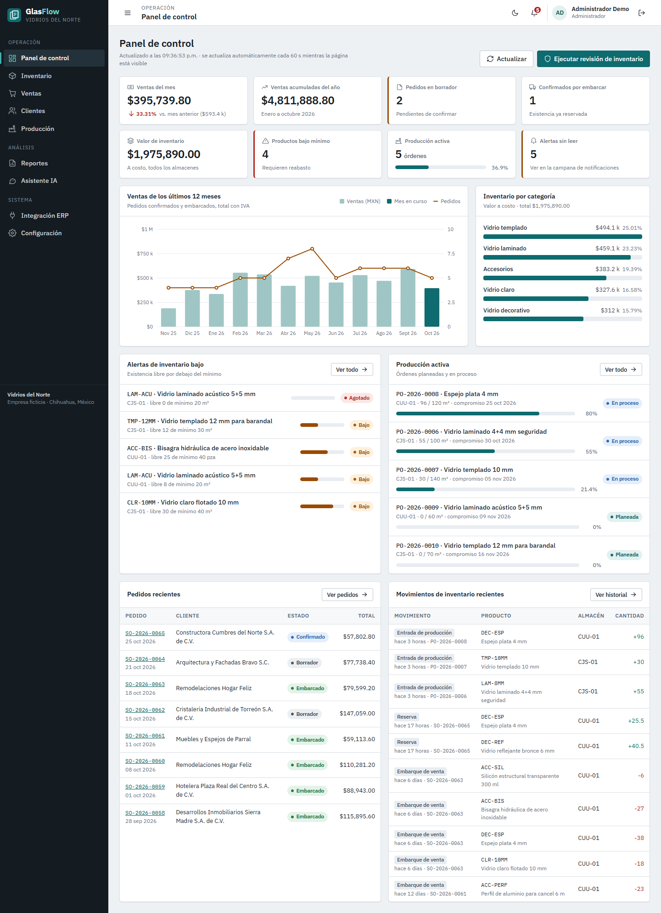
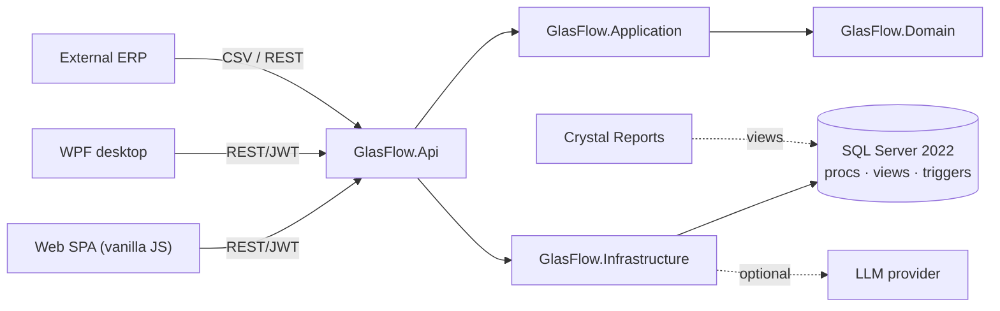
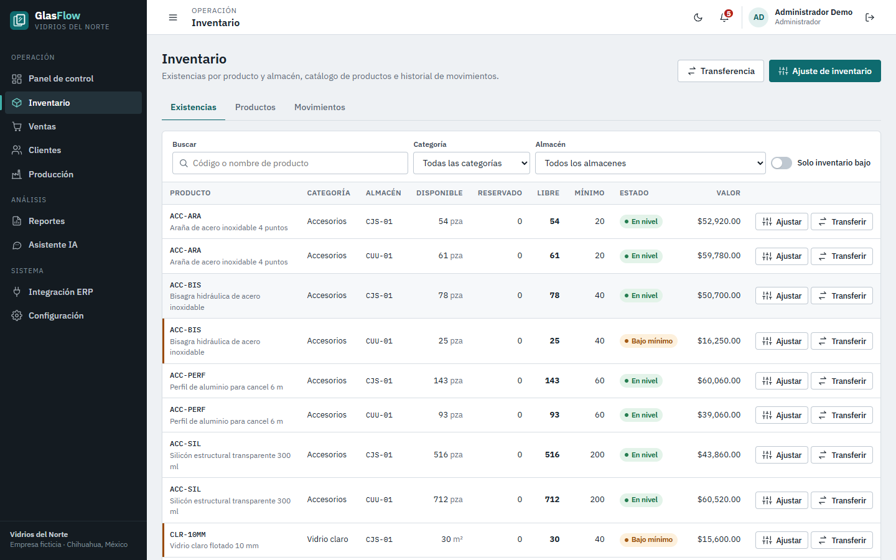
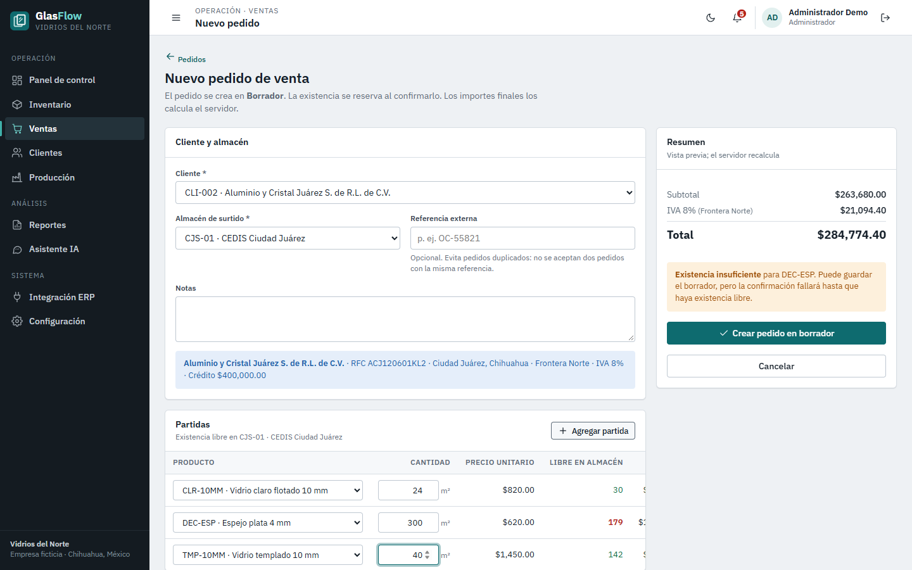
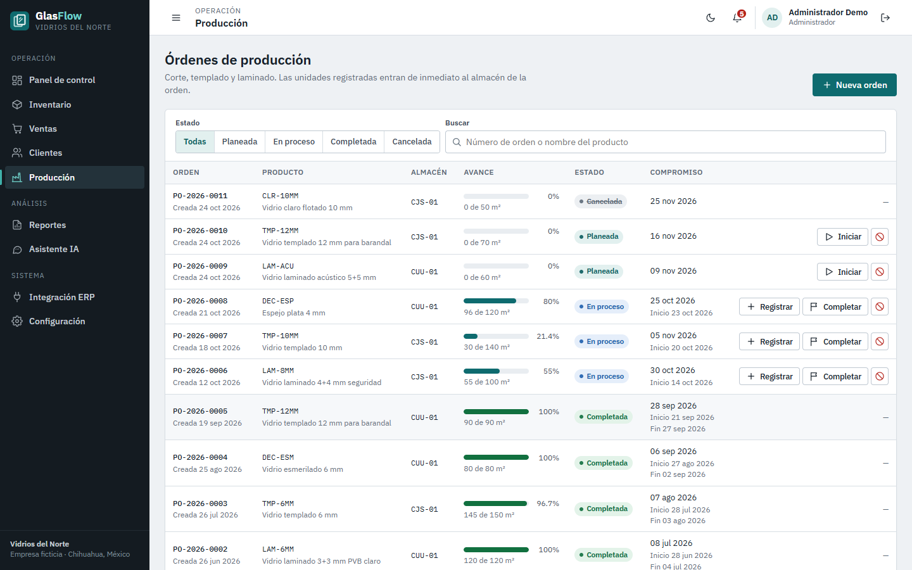
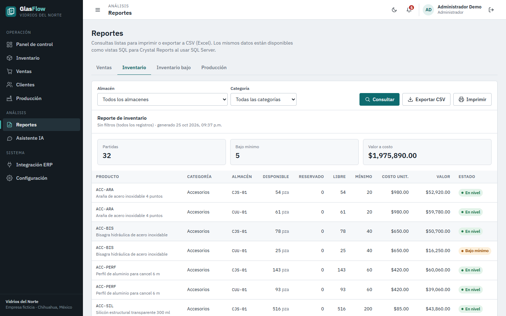
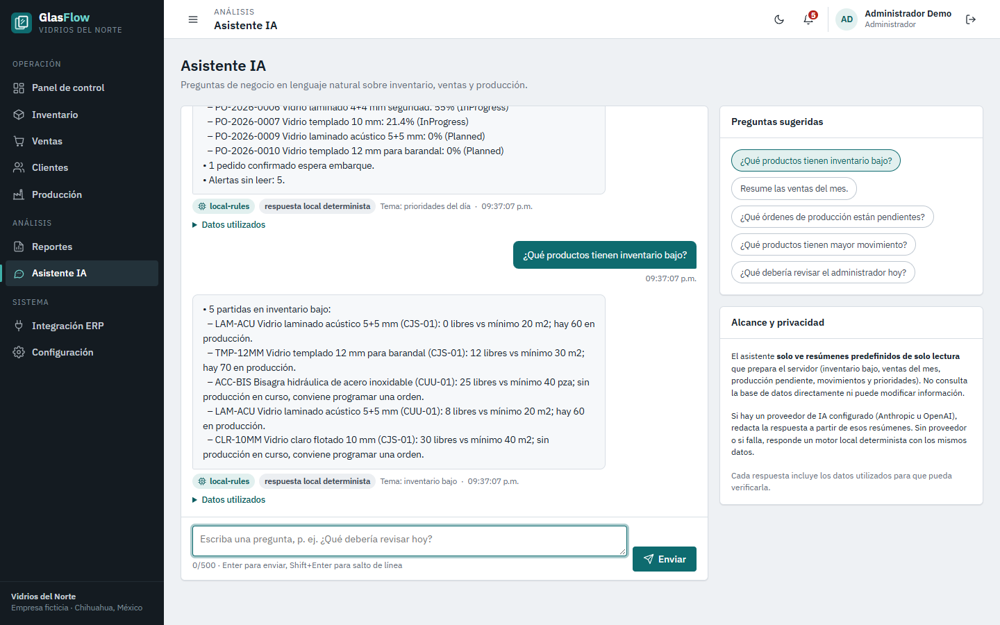
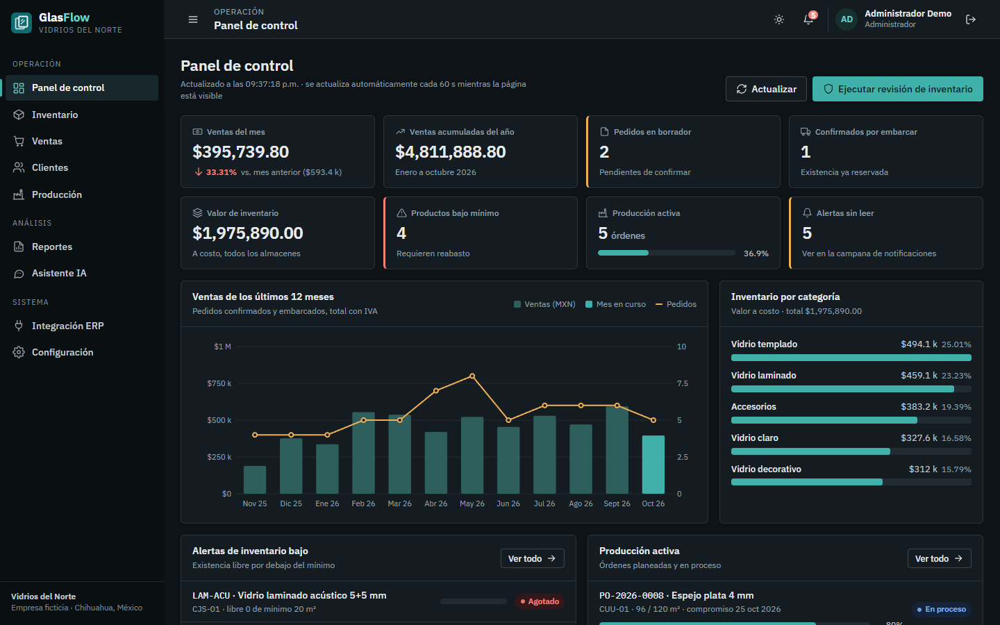

# GlasFlow ERP

**Full-stack ERP-style business management application built with C#, .NET, SQL Server, JavaScript, WPF, business process automation, reporting, and AI-powered operational insights.**

GlasFlow ERP runs the day-to-day operation of *Vidrios del Norte*, a **fictional** glass manufacturer and distributor in Chihuahua, Mexico: customers, suppliers, glass catalog and stock across warehouses, sales orders with Mexican IVA, production orders, inventory movements, reports, ERP import/export and an AI operations assistant. It ships a web dashboard and a Windows (WPF) desktop client, and both use the same REST API.

> Portfolio project. All companies, people, RFCs, addresses and figures are invented. It is not affiliated with any real company.



---

## Problem and use case

A mid-size glass company typically runs on spreadsheets plus a corporate ERP that is hard to adapt to the shop floor. Planners need to know what can be promised today, which tempered or laminated products are under minimum, what production is late, and what to review each morning. They need these answers without a manual reconciliation of stock, reservations and production.

GlasFlow covers that operational layer:

- **Sales** reserves stock on confirmation and deducts it on shipment, with IVA at 16% general / 8% border zone (Ciudad Juárez).
- **Production** posts finished goods to the warehouse as units are registered.
- **Every stock change** leaves an auditable movement.
- **Automation** raises low-stock alerts without duplicates.
- **Integration** gives the corporate ERP clean CSV/REST interfaces keyed by external identifiers.
- **Reporting** exposes the data to Crystal Reports through report-ready SQL Server views.

## Architecture



| Layer | Contents |
|---|---|
| `src/GlasFlow.Domain` | Entities and business rules (state machines, stock rules, IVA) |
| `src/GlasFlow.Application` | Services, DTOs + validation, automation, reports, import, AI orchestration |
| `src/GlasFlow.Infrastructure` | EF Core 10 (SQL Server / SQLite), migrations, seeding, SQL-object installer, AI providers |
| `src/GlasFlow.Api` | ASP.NET Core 10 Web API, JWT auth, ProblemDetails, rate limits, Swagger, health, scheduler, web UI (`wwwroot`) |
| `src/GlasFlow.Desktop` | WPF MVVM client of the same API |
| `database/` | SQL Server scripts 01–06 |
| `tests/GlasFlow.Tests` | xUnit unit, service and HTTP integration tests |

More in [docs/ARCHITECTURE.md](docs/ARCHITECTURE.md).

## Technology stack

C# 14 / .NET 10 · ASP.NET Core Web API · Entity Framework Core 10 · SQL Server 2022 Express (T-SQL procedures, views, triggers) · SQLite fallback · JWT bearer + PBKDF2 · OpenAPI + Swagger UI · HTML5 / CSS / vanilla JavaScript modules (no build, no CDN scripts, hand-written SVG charts) · WPF (MVVM, no third-party packages) · xUnit + `WebApplicationFactory` · Playwright (only to capture screenshots).

## Features

| Area | What you can do |
|---|---|
| Dashboard | Sales this month vs last, YTD, draft/confirmed orders, inventory value, low-stock count, production progress, 12-month sales chart, inventory by category, alerts, recent orders and movements; auto-refresh |
| Inventory | Stock by product × warehouse with search, category and warehouse filters and a low-stock flag; product CRUD; signed adjustments; transfers; movement history |
| Customers | CRUD with RFC / postal-code validation, tax zone, credit limit; detail with billed total and order history |
| Sales | Create orders (server-side totals + IVA), confirm (reserve), ship (deduct), cancel (release); duplicate-submission protection |
| Production | Plan, start, register units (posted to stock), complete, cancel; progress bars |
| Reports | Sales, inventory, low stock, production; date/status/warehouse filters; totals; CSV export; print layout |
| ERP integration | CSV catalog import with mapping, dry run and row errors; product/customer exports; mapping endpoint |
| AI assistant | Spanish business Q&A over predefined data summaries; LLM optional, deterministic fallback |
| Settings | App, database, SQL objects, AI and automation status; configuration help; audit log (Admin) |
| Security | JWT, roles Admin / Operator / Viewer, rate limits, validation, audit trail |

## Database design

Twelve normalized tables are generated from the EF Core model, with primary and foreign keys, unique indexes (business codes, filtered unique `ExternalId`s), check constraints (statuses, categories, units, amounts, quantities), `decimal(18,2)` money and `decimal(18,3)` quantities:

`Customers · Suppliers · Products · Warehouses · Inventory · SalesOrders · SalesOrderDetails · ProductionOrders · InventoryMovements · Users · AuditLogs · Notifications`

See [docs/DATABASE_DESIGN.md](docs/DATABASE_DESIGN.md) (ER diagram, constraints, design decisions).

## SQL Server implementation

| Script | Contents |
|---|---|
| `01_schema.sql` | Database and schema (generated from the EF migration, idempotent) |
| `02_seed_data.sql` | Idempotent fictional seed: master data plus a consistent sample of orders, production and movements |
| `03_stored_procedures.sql` | `usp_CreateSalesOrder`, `usp_ConfirmSalesOrder`, `usp_ShipSalesOrder`, `usp_CancelSalesOrder`, `usp_UpdateInventory`, `usp_StartProductionOrder`, `usp_RegisterProduction`, `usp_CompleteProductionOrder`, `usp_GetInventorySummary`, `usp_RunLowStockCheck`. Each uses transactions, `XACT_ABORT`, `TRY/CATCH` + `THROW` and `UPDLOCK/HOLDLOCK` |
| `04_views.sql` | `vw_CurrentInventory`, `vw_LowStockProducts`, `vw_SalesByMonth`, `vw_CustomerSalesSummary`, `vw_ProductionStatus`, `vw_InventoryMovementHistory`, `vw_SalesReport` |
| `05_triggers.sql` | `trg_Inventory_Audit`, `trg_InventoryMovements_Audit`, `trg_Products_PriceAudit`, `trg_ProductionOrders_StatusAudit`. They are set-based, write `AuditLogs` with `Source='DB_TRIGGER'`, and record the application user via `SESSION_CONTEXT` |
| `06_reports.sql` | Analytical queries: JOINs, GROUP BY/HAVING, subqueries, CTEs, window functions (running balances, RANK, LAG month-over-month, ABC classification, stock-ledger reconciliation) |

The API applies the migration and deploys 03–05 automatically on startup (SQL Server provider). The procedures are an equivalent server-side implementation of the C# workflows, for SSMS, SQL Agent jobs, Crystal Reports or ERP integrations. The API itself runs the workflows in C# so that they also work on SQLite. Execution order and manual instructions are in [database/README.md](database/README.md).

## Automation

- **Low-stock detection and notifications.** Runs after every stock change, at startup, every 15 minutes (`LowStockMonitor`), and on demand (`POST /api/inventory/check`). It is idempotent: a filtered unique index allows only one open alert per product and warehouse, and recovered items are auto-resolved.
- **Workflow transitions.** Sales: Draft → Confirmed → Shipped / Cancelled. Production: Planned → InProgress → Completed / Cancelled. Inventory movements and business notifications are generated automatically.
- **Dashboard.** The web dashboard refreshes itself every 60 seconds.

## AI implementation

`IAiProvider` abstraction with Anthropic and OpenAI-compatible implementations, selected by configuration; the key comes only from environment variables. The model never touches the database: each question maps to one fixed read-only summary (`BusinessDataService`) and only that JSON is sent. With no key, or on any provider error, the assistant returns a deterministic Spanish summary built from the same data. Details: [docs/AI_ASSISTANT.md](docs/AI_ASSISTANT.md).

## ERP integration

REST API, external identifiers for products and customers, idempotent order intake (`externalReference`), and CSV catalog import with column/category mapping, validation, dry run and per-row errors. Products and customers can be exported as CSV. Sample files are in `samples/`. See [docs/ERP_INTEGRATION.md](docs/ERP_INTEGRATION.md). No real ERP is connected.

## Crystal Reports

**Crystal Reports is not installed in this environment and no `.rpt` file is included.** What exists:

- report-ready SQL views (`vw_SalesReport`, `vw_CurrentInventory`, `vw_ProductionStatus`, …);
- JSON and CSV report endpoints;
- printable web layouts;
- a connection guide plus field, group and formula specifications for three reports.

See [docs/CRYSTAL_REPORTS.md](docs/CRYSTAL_REPORTS.md).

## Desktop application

`src/GlasFlow.Desktop` is a WPF client (dashboard with chart, inventory with stock adjustment, product management, sales orders with create/confirm/ship/cancel). It is a thin client of the same API, with no business logic and no direct database access. Build and run instructions are in [src/GlasFlow.Desktop/README.md](src/GlasFlow.Desktop/README.md).

## Installation

**Requirements:** Windows 10/11, [.NET 10 SDK](https://dotnet.microsoft.com/download), and SQL Server 2022 Express (or LocalDB / Developer). To skip SQL Server, use the SQLite mode.

```powershell
git clone <this repo> GlasFlow-ERP
cd GlasFlow-ERP
dotnet tool restore                              # dotnet-ef (only needed to change the schema)

# Choose the demo password for users admin / operador / consulta
$env:Auth__DemoPassword = "<choose-a-password>"

# A) SQL Server Express (default connection: Server=.\SQLEXPRESS, Windows authentication)
dotnet run --project src/GlasFlow.Api --launch-profile http

# B) No SQL Server: SQLite file database
dotnet run --project src/GlasFlow.Api --launch-profile sqlite
```

Open **http://localhost:5080** for the web app or **http://localhost:5080/swagger** for the API. On first start the API:

1. creates or migrates the database;
2. installs the procedures, views and triggers (SQL Server);
3. seeds 12 months of fictional history (74 sales orders, 11 production orders, about 230 movements);
4. runs the first low-stock check.

If you don't set `Auth__DemoPassword`, a random password is generated on first seed and printed in the console.

Desktop client (API running):

```powershell
dotnet run --project src/GlasFlow.Desktop
```

**Cloud demo:** one-click Render deployment (Docker + SQLite), described in [docs/DEPLOYMENT.md](docs/DEPLOYMENT.md).

Manual SQL setup without the API: run `database/01` → `05` with sqlcmd or SSMS (see `database/README.md`).

## Configuration

All settings are standard ASP.NET Core configuration; use environment variables for secrets. The full list is in [.env.example](.env.example).

| Variable | Purpose |
|---|---|
| `ConnectionStrings__GlasFlow` | SQL Server connection |
| `Database__Provider` | `SqlServer` (default) or `Sqlite` |
| `Auth__JwtKey` | JWT signing key (≥ 32 chars; required outside Development) |
| `Auth__DemoPassword` | Demo users' password |
| `Ai__Provider`, `GLASFLOW_AI_API_KEY` / `Ai__ApiKey`, `Ai__Model`, `Ai__BaseUrl` | Optional LLM |
| `Inventory__AllowNegativeStock` | Allow negative free stock (default `false`) |
| `Automation__InventoryCheckMinutes` | Scheduled low-stock check interval (0 disables) |

## API documentation

Swagger UI at `/swagger`; endpoint reference in [docs/API_DOCUMENTATION.md](docs/API_DOCUMENTATION.md). The health check is at `/health`.

## Testing

```powershell
dotnet test
```

71 tests (domain unit tests, service tests on real EF Core + SQLite, HTTP integration tests through the full ASP.NET pipeline). Latest run: **71 passed, 0 failed**. The SQL scripts were verified separately against SQL Server 2022 Express. Coverage and gaps: [docs/TESTING.md](docs/TESTING.md).

## Screenshots

Real captures of the running application (Microsoft Edge via Playwright), in `docs/screenshots/`:

| | |
|---|---|
|  |  |
| Inventory with low-stock indicators | New sales order: live IVA preview and stock warning |
|  |  |
| Production orders | Reports with CSV export and print |
|  |  |
| AI assistant (deterministic fallback) | Dark theme |

## Implementation status

| Status | Items |
|---|---|
| **Fully implemented and verified** | REST API and all business workflows (verified on SQL Server and SQLite); schema, constraints, migrations; seed; stored procedures, views, triggers (exercised with sqlcmd, including failure cases and idempotent re-runs); automation; CSV import/export; reports + CSV; JWT auth and roles; web frontend (scripted end-to-end run of every page in Edge); AI assistant fallback path; 71 automated tests |
| **Implemented, partially verified** | WPF desktop client: builds with 0 warnings, and a headless `--smoke` run against the API passes, but the screens were not clicked through and there are no desktop screenshots. LLM providers: implemented against the providers' public HTTP APIs, but not called live (no key here) |
| **Documented, not implemented** | Native Crystal Reports `.rpt` files (runtime not installed); connectors to a specific real ERP; webhooks / message queue; OAuth2 client credentials |
| **Not tested** | Load / concurrency under real multi-user traffic; deployment to a server; printing to a physical printer |

## Future improvements

Purchase orders and supplier receipts; lot / glass-sheet dimension tracking (cut optimization); CFDI 4.0 invoicing through a PAC; outbound webhooks with an outbox table; OAuth2/Entra ID; Docker compose with SQL Server on Linux; CI pipeline (GitHub Actions running `dotnet test`); desktop UI tests; localization of API error messages.

## License

[MIT](LICENSE) © 2026 Angel Francisco Aguayo Salazar
