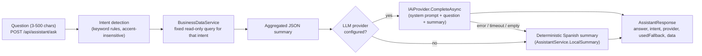

# AI business assistant

The assistant answers operational questions in Spanish ("¿Qué productos tienen inventario bajo?", "Resume las ventas del mes", "¿Qué debería revisar el administrador hoy?") using live application data. It works **with or without** an LLM.

## Flow



## Safety design

- **No database access for the model.** The LLM never generates or runs SQL. Each intent maps to one predefined, parameter-free, read-only method in `BusinessDataService` (`LowStockAsync`, `SalesSummaryAsync`, `ProductionStatusAsync`, `TopMoversAsync`, `DailyBriefingAsync`). Only their aggregated results are sent.
- **Minimal data.** Summaries contain product codes, quantities, totals and customer company names; no emails, phones, RFCs, users or passwords.
- **Prompt hardening.** The system prompt restricts answers to the provided data, forbids inventing figures and tells the model to ignore instructions contained in data.
- **Input validation.** Question length is checked (DTO validation + service check); the endpoint is authenticated and rate limited (20 requests/min).
- **Failure isolation.** Provider errors are logged without the payload and the user gets the deterministic answer; the feature never returns 500 because a provider is down.
- **Secrets.** The API key comes only from configuration (`Ai__ApiKey` or `GLASFLOW_AI_API_KEY`). `/api/system/status` reports whether a key exists, never its value.

## Providers

`IAiProvider` (Application) has two implementations (Infrastructure), selected by `Ai:Provider`:

| `Ai:Provider` | Class | Endpoint | Notes |
|---|---|---|---|
| `none` (default) | – | – | Deterministic summaries only |
| `anthropic` | `AnthropicProvider` | `POST {BaseUrl or https://api.anthropic.com}/v1/messages` | Default model `claude-sonnet-5-5`, override with `Ai:Model` |
| `openai` | `OpenAiCompatibleProvider` | `POST {BaseUrl or https://api.openai.com/v1}/chat/completions` | Any OpenAI-compatible gateway (OpenAI, Azure-compatible proxies, local servers); `Ai:Model` required |

Adding a provider = one class implementing `IAiProvider` + one DI registration.

```powershell
$env:Ai__Provider = "anthropic"
$env:GLASFLOW_AI_API_KEY = "<your key>"   # never commit it
dotnet run --project src/GlasFlow.Api
```

## Testing status

- Intent mapping for the five suggested questions and the deterministic low-stock summary are covered by unit tests; the HTTP test verifies the fallback path end to end (`usedFallback: true`).
- The LLM providers were **not** exercised against a live API in this environment (no key configured). Their request/response shapes follow the providers' public HTTP APIs; any provider error falls back to the local answer.
