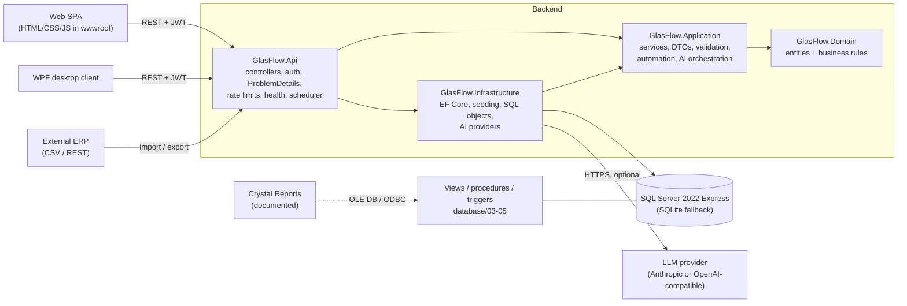

# Architecture

GlasFlow ERP is a layered .NET 10 solution with one backend shared by two clients.

## Projects

| Project | Responsibility | Depends on |
|---|---|---|
| `GlasFlow.Domain` | Entities and invariants: order status transitions, stock reservation/shipping/adjustment rules, production limits, IVA calculation (`TaxCalculator`), product validation. No framework dependencies. | – |
| `GlasFlow.Application` | Use-case services (`SalesOrderService`, `ProductionService`, `InventoryService`, `ImportService`, `ReportService`, `DashboardService`, `InventoryAlertService`, `AssistantService`…), request/response DTOs with DataAnnotations, paging, audit. Talks to persistence through `IGlasFlowDbContext`. | Domain, EF Core abstractions |
| `GlasFlow.Infrastructure` | `GlasFlowDbContext` (keys, indexes, check constraints, triggers declared to EF), migrations, idempotent `DataSeeder`, `SqlServerObjectsInstaller`, PBKDF2 `PasswordHasher`, AI providers. | Application |
| `GlasFlow.Api` | ASP.NET Core host: controllers, JWT auth + role policies, exception → ProblemDetails mapping, rate limiting, CORS, OpenAPI + Swagger UI, `/health`, `LowStockMonitor` background service, static web UI. | Infrastructure |
| `GlasFlow.Desktop` | WPF MVVM client calling the same REST API. No business logic, no direct DB access. | (HTTP only) |
| `GlasFlow.Tests` | xUnit: domain unit tests, service tests on real EF Core + SQLite, HTTP integration tests via `WebApplicationFactory`. | Api |

The layering is deliberately modest (no MediatR, repositories or CQRS frameworks): services use EF Core directly through an interface, which keeps the code short while still letting tests run the real queries.

## Key design decisions

- **Business rules live in one place.** Entities enforce invariants (`SalesOrder.MarkConfirmed`, `InventoryItem.Reserve`, `ProductionOrder.RegisterCompleted`); services orchestrate them inside transactions. Clients never compute authoritative totals or stock.
- **Transactions around multi-step workflows.** Confirm/ship/cancel orders, register/complete production, adjustments, transfers and imports each run in one `BeginTransactionAsync` → commit, so stock, movements, audit rows and notifications succeed or fail together. The SQL Server retrying execution strategy is intentionally not enabled because it forbids user-initiated transactions.
- **Optimistic concurrency** on `Inventory.Version` (concurrency token): two users reserving the same stock cannot both win; the loser gets HTTP 409.
- **Reserve, then ship.** Confirming an order reserves stock (`QuantityReserved`), shipping deducts it (`QuantityAvailable`), cancelling releases it. Free stock = available − reserved; it may not go negative unless `Inventory:AllowNegativeStock=true`.
- **Every stock change creates an `InventoryMovement`** (signed quantity + business reference such as `SO-2026-0042`). Seed data is generated so that opening balance + all movements equals on-hand stock.
- **Auditing at two levels.** The application writes `AuditLogs` (`Source=APP`) for every business operation, with the authenticated user. SQL Server triggers add `Source=DB_TRIGGER` rows for direct data changes, including changes made outside the app.
- **Provider switch.** `Database:Provider=SqlServer` (default; migrations + procedures/views/triggers) or `Sqlite` (zero-install fallback and fast tests; `EnsureCreated`, decimals stored as REAL). SQL Server-only features (views endpoint, triggers, procedures) report "SQL Server only" instead of failing on SQLite.
- **Strings for enums** in the database (with CHECK constraints) so tables, views and Crystal Reports stay readable without lookup joins.

## Request pipeline

`ExceptionHandler` (ProblemDetails) → static files (web UI) → CORS → authentication (JWT bearer) → authorization (fallback policy: authenticated; writes need `Admin`/`Operator`, deletes `Admin`) → rate limiter (login, assistant) → controllers. `[ApiController]` model validation returns 400 with field errors; `DomainException` → 422, `NotFoundException` → 404, `ConflictException`/concurrency/unique violations → 409, anything else → 500 without internals.

## Automation

| Process | Trigger | Implementation |
|---|---|---|
| Low-stock detection + notification | After every stock-changing operation, on startup, every `Automation:InventoryCheckMinutes` (default 15) and on demand (`POST /api/inventory/check`) | `InventoryAlertService` — idempotent: a filtered unique index on `Notifications.DedupKey WHERE IsResolved = 0` guarantees one open alert per product/warehouse; recovered items are auto-resolved. |
| Sales order status transitions | Confirm / ship / cancel endpoints | `SalesOrderService` + domain state machine |
| Production completion | Register / complete endpoints | `ProductionService` posts finished goods, movement, notification |
| Movement generation | Every stock change | `InventoryService.AddMovement` |
| Dashboard refresh | Web UI polls `/api/dashboard` every 60 s | Dashboard KPIs computed live from the database |
| Business notifications | Order confirmed/shipped, production completed, import finished | `NotificationService` |

All automation uses an injected `TimeProvider`, so tests control time.

## Security summary

JWT bearer auth (HMAC-SHA256, key from `Auth:JwtKey`; required outside Development), PBKDF2-SHA256 password hashes (100k iterations), role-based authorization, rate limiting on login and assistant, uniform login failure message, DataAnnotations validation on every request DTO, EF Core parameterized queries only (the one raw view query uses a whitelisted name and a parameter), CORS closed by default, HSTS outside Development, no secrets in source (`.env.example` documents the variables). Development limitations: demo users with a shared demo password, ephemeral JWT key when none is configured, HTTP (not HTTPS) on localhost.
