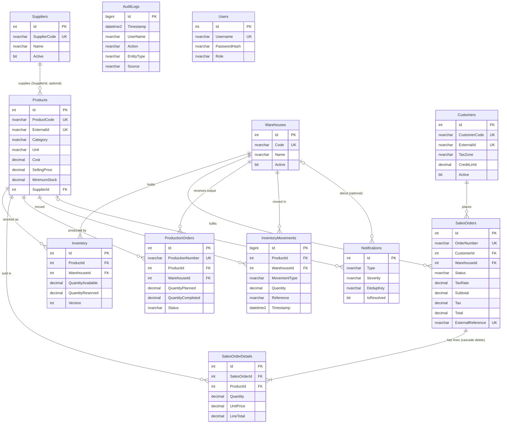

# GlasFlow ERP — Database design

SQL Server database `GlasFlowERP`. The schema comes from the EF Core model (`GlasFlowDbContext`) and is
exported to [`database/01_schema.sql`](../database/01_schema.sql). That file is the source of truth for column types and
constraints. The procedures, views and triggers (`database/03`–`05`) are hand-written T-SQL that the API
deploys at start-up. See [`database/README.md`](../database/README.md) for how to run the scripts.

## Entity-relationship overview

`AuditLogs` and `Users` have no foreign keys on purpose. The audit trail must survive the deletion or renaming of
whatever it describes, and it stores the user *name* as it was at the time.

## Tables

All `CreatedAt` / `UpdatedAt` / `Timestamp` columns are `datetime2` in **UTC**. All foreign keys are
`ON DELETE NO ACTION`, except `SalesOrderDetails → SalesOrders`, which cascades.

### Master data

| Table | Purpose | Key columns | Constraints | Indexes |
|---|---|---|---|---|
| **Warehouses** | Plant / distribution centres (`CUU-01` Chihuahua plant, `CJS-01` Ciudad Juárez CEDIS). | `Code` nvarchar(20) | — | `IX_Warehouses_Code` unique |
| **Suppliers** | Glass, film, hardware and sealant vendors. | `SupplierCode` nvarchar(20), `Rfc` nvarchar(13) | — | `IX_Suppliers_SupplierCode` unique |
| **Customers** | Construction firms, glaziers and hotels. `TaxZone` sets the IVA rate. | `CustomerCode`, `ExternalId` (external-ERP id), `TaxZone`, `CreditLimit` decimal(18,2) | `CK_Customers_TaxZone` (`General`,`FronteraNorte`), `CK_Customers_CreditLimit` (≥ 0) | `CustomerCode` unique; `ExternalId` unique **filtered** (`IS NOT NULL`); `Name` |
| **Products** | Glass (m²) and accessories (pza). `MinimumStock` is per warehouse; 0 = not tracked. | `ProductCode`, `ExternalId` (external-ERP SKU), `Category`, `Unit`, `Cost`/`SellingPrice` decimal(18,2), `MinimumStock` decimal(18,3), `SupplierId` | `CK_Products_Category` (5 Spanish categories), `CK_Products_Unit` (`m2`,`pza`,`ml`,`kg`), `CK_Products_Cost` (≥ 0), `CK_Products_SellingPrice` (> 0), `CK_Products_MinimumStock` (≥ 0) | `ProductCode` unique; `ExternalId` unique filtered; `Category`; `SupplierId` |
| **Users** | Application logins (PBKDF2 hash created by the API, never by SQL scripts). | `Username`, `Role` | `CK_Users_Role` (`Admin`,`Operator`,`Viewer`) | `Username` unique |

### Stock

| Table | Purpose | Key columns | Constraints | Indexes |
|---|---|---|---|---|
| **Inventory** | Current stock of one product in one warehouse. Free stock = `QuantityAvailable − QuantityReserved`. | `QuantityAvailable` (on hand) and `QuantityReserved` (committed to confirmed orders), both decimal(18,3); `Version` int (concurrency token) | `CK_Inventory_Reserved` (≥ 0); "free ≥ 0" is enforced by the domain and the procedures (see decisions) | `(ProductId, WarehouseId)` unique; `WarehouseId` |
| **InventoryMovements** | Append-only stock ledger. `Quantity` is signed (+ in / − out). `Reference` is the business document (`SO-2026-0007`, `PO-2026-0003`, `ADJ-…`, `TRF-…`, `SALDO-INICIAL`). | `MovementType`, `Quantity` decimal(18,3), `Reference`, `UserName` | `CK_InventoryMovements_Type` (`Adjustment`, `Reservation`, `ReservationRelease`, `SaleShipment`, `ProductionReceipt`, `TransferOut`, `TransferIn`, `Import`) | `(ProductId, Timestamp)`; `(WarehouseId, Timestamp)`; `Reference` |

The ledger and the table reconcile. For every stock row, the sum of all movements except
`Reservation`/`ReservationRelease` equals `QuantityAvailable`. Reservations are informational and do not
change on-hand stock. `06_reports.sql` R5 checks this equation.

### Sales and production

| Table | Purpose | Key columns | Constraints | Indexes |
|---|---|---|---|---|
| **SalesOrders** | Order header. Workflow: `Draft → Confirmed` (stock reserved) `→ Shipped` (stock deducted). `Draft`/`Confirmed` can go to `Cancelled`. | `OrderNumber` `SO-YYYY-NNNN` (restarts every year); `TaxRate` decimal(5,4) frozen at creation (0.16 General / 0.08 FronteraNorte); `Subtotal`, `Tax`, `Total`; `ExternalReference` (client idempotency key) | `CK_SalesOrders_Status`; `CK_SalesOrders_Amounts` (`Subtotal ≥ 0 AND Tax ≥ 0 AND Total = Subtotal + Tax`) | `OrderNumber` unique; `ExternalReference` unique filtered; `(CustomerId, OrderDate)`; `(Status, OrderDate)`; `WarehouseId` |
| **SalesOrderDetails** | Order lines. `LineTotal = ROUND(Quantity × UnitPrice, 2)`. | `Quantity` decimal(18,3), `UnitPrice` and `LineTotal` decimal(18,2) | `CK_SalesOrderDetails_Quantity` (> 0), `CK_SalesOrderDetails_UnitPrice` (> 0) | `(SalesOrderId, ProductId)` unique (a product appears once per order); `ProductId` |
| **ProductionOrders** | Manufacturing orders for glass products (accessories are bought, not produced). Workflow: `Planned → InProgress → Completed`; `Cancelled` is allowed before completion. | `ProductionNumber` `PO-YYYY-NNNN`, `QuantityPlanned`, `QuantityCompleted`, `DueDate`, `StartDate`, `CompletionDate` | `CK_ProductionOrders_Status`; `CK_ProductionOrders_Quantities` (`Planned > 0`, `0 ≤ Completed ≤ Planned`) | `ProductionNumber` unique; `(Status, DueDate)`; `ProductId`; `WarehouseId` |

### System

| Table | Purpose | Key columns | Constraints | Indexes |
|---|---|---|---|---|
| **Notifications** | In-app alerts (`LowStock`, `OrderConfirmed`, `OrderShipped`, `ProductionCompleted`, `ImportCompleted`), with severity `Info` / `Warning` / `Critical`. | `DedupKey` (e.g. `LOWSTOCK:12:1`), `IsRead`, `IsResolved`, `ResolvedAt` | — | `DedupKey` unique **filtered** `WHERE DedupKey IS NOT NULL AND IsResolved = 0`; `(IsRead, CreatedAt)`; `ProductId`; `WarehouseId` |
| **AuditLogs** | Who did what and when. `Source` tells writers apart: `APP` (API), `DB_PROC` (procedures), `DB_TRIGGER` (triggers), `DB_SEED` (seed script). | `Action`, `EntityType`, `EntityId` nvarchar(60), `Details` nvarchar(max) | — | `Timestamp`; `(EntityType, EntityId)` |

## Design decisions

- **Decimal precision.** Money is `decimal(18,2)`. Quantities are `decimal(18,3)`, because glass is sold in m² with
  fractions and 3 decimals covers cm² precision. The tax rate is `decimal(5,4)`. There is no `float` anywhere, so
  sums are exact. Rounding is half away from zero to 2 decimals, in both C#
  (`MidpointRounding.AwayFromZero`) and T-SQL (`ROUND(x, 2)` on decimals). Tax is rounded once, on the
  subtotal, the way an invoice is.
- **Enums stored as strings with CHECK constraints.** `Status`, `MovementType`, `TaxZone`, `Role`, `Category` and `Unit` are
  readable `nvarchar` values (EF `HasConversion<string>()`), so reports, SSMS and Crystal Reports need no lookup
  tables. A CHECK constraint per column rejects any other value, even from clients that bypass the API.
- **Business keys versus surrogate keys.** Every table has an `int`/`bigint` identity PK used by foreign keys. Users and
  integrations use the unique business codes (`ProductCode`, `CustomerCode`, `OrderNumber`, …). The seed script and
  imports are idempotent because they match on those codes.
- **Filtered unique indexes.** Optional identifiers (`ExternalId`, `ExternalReference`) are unique only when present,
  because a plain unique index would allow just one NULL. `IX_Notifications_DedupKey` allows *one open* alert per condition
  and keeps any number of resolved ones as history. The database itself stops duplicate low-stock alerts, even if two
  checks run at the same time.
- **Optimistic concurrency.** `Inventory.Version` is an EF concurrency token. Every stock change, from the API and from
  the procedures, increments it. A stale EF update therefore matches 0 rows and fails instead of silently overwriting
  a reservation. The procedures also take `UPDLOCK, HOLDLOCK` on rows they read and then write, which serializes
  concurrent confirmations of the same stock and concurrent order-number generation.
- **Free stock never negative.** The schema checks `QuantityReserved ≥ 0`. "Free ≥ 0" is a business rule with a
  configuration switch (`Inventory:AllowNegativeStock`), so the domain and the procedures enforce it rather than a
  constraint. The procedures always enforce it.
- **Soft deletes.** Master data is deactivated (`Active = 0`) instead of deleted, because orders, movements and
  audit rows keep pointing at it. `NO ACTION` foreign keys make a hard delete of a used product fail. Inactive
  products are left out of stock views, alerts and new orders. Order lines are the only cascade delete, since they
  have no meaning without their header.
- **Ledger plus snapshot.** `Inventory` is the fast current snapshot. `InventoryMovements` is the append-only history
  that explains it. Both are written in the same transaction.
- **Triggers declared to EF.** The four tables with triggers are configured with `HasTrigger("trg_…")`. SQL Server
  forbids `OUTPUT` without `INTO` on tables with triggers, which EF uses by default to read identities. With the
  declaration, EF uses a compatible statement. The triggers use `SET NOCOUNT ON`, so the row count EF uses for
  concurrency checks is unchanged. This was verified by running the API with the triggers installed.
- **Triggers never break writes.** Audit inserts run with `SET XACT_ABORT OFF` inside `TRY/CATCH`, and text is cut
  to the column length. If writing an audit row fails, the row is dropped and the business transaction still commits.
- **UTC everywhere.** The API uses `TimeProvider.GetUtcNow()` and SQL uses `SYSUTCDATETIME()`. Reports convert to local time when they display it.

## Programmable objects

### Stored procedures (`database/03_stored_procedures.sql`)

| Procedure | Purpose |
|---|---|
| `usp_CreateSalesOrder` | Creates a Draft order from a JSON array of lines. Validates the customer, warehouse and products (they must exist and be active), duplicate lines, a duplicate `ExternalReference`, quantity and price. Computes line and order totals and IVA by tax zone, and assigns the next `SO-YYYY-NNNN`. |
| `usp_ConfirmSalesOrder` | Draft → Confirmed. Reserves every line in one step or fails with a list of all shortages. Writes `Reservation` movements. |
| `usp_ShipSalesOrder` | Confirmed → Shipped. Deducts the reserved stock and writes negative `SaleShipment` movements. |
| `usp_CancelSalesOrder` | Draft/Confirmed → Cancelled. Releases reservations with negative `ReservationRelease` movements. |
| `usp_UpdateInventory` | Signed manual adjustment. Creates the stock row if it is missing. Refuses negative stock or stock below the reserved quantity. Writes an `Adjustment` movement. |
| `usp_StartProductionOrder` | Planned → InProgress. |
| `usp_RegisterProduction` | Registers finished units on an InProgress order (no more than planned) and receives them into stock with a `ProductionReceipt` movement. |
| `usp_CompleteProductionOrder` | Optionally registers a final quantity, then InProgress → Completed. Requires at least one completed unit. |
| `usp_GetInventorySummary` | Read-only. Returns stock per product and warehouse, plus a second result set with totals by category. |
| `usp_RunLowStockCheck` | Same logic as `InventoryAlertService`. Opens one `LowStock` alert per key, resolves recovered ones, and is idempotent. |

All mutating procedures use `SET XACT_ABORT ON` and `TRY/TRAN/CATCH → ROLLBACK + THROW`, and write `AuditLogs` (`DB_PROC`).

### Views (`database/04_views.sql`)

`vw_CurrentInventory`, `vw_LowStockProducts`, `vw_SalesByMonth`, `vw_CustomerSalesSummary`, `vw_ProductionStatus`,
`vw_InventoryMovementHistory` (with a running on-hand balance) and `vw_SalesReport` (one row per order line; the
Crystal Reports sales dataset). The API exposes them read-only at `GET /api/reports/views/{name}`, limited to a
whitelist in `ReportsController.ReportViews`. Sales views count only `Confirmed` and `Shipped` orders.

### Triggers (`database/05_triggers.sql`)

| Trigger | Table / event | Audits |
|---|---|---|
| `trg_Inventory_Audit` | `Inventory` AFTER UPDATE | `StockChanged`: available and reserved, old → new, and the version |
| `trg_InventoryMovements_Audit` | `InventoryMovements` AFTER INSERT | `ManualAdjustment` for every `Adjustment`; `LargeMovement` for physical movements with \|qty\| ≥ 1000. Kept lean on purpose: the other movements are already ledger rows covered by the stock and business audits. |
| `trg_Products_PriceAudit` | `Products` AFTER UPDATE | `PriceChanged`: price and cost old → new, and the % change |
| `trg_ProductionOrders_StatusAudit` | `ProductionOrders` AFTER UPDATE | `ProductionStatusChanged`: old → new status |

All of them are set-based (they handle multi-row statements), write `Source = 'DB_TRIGGER'`, and take the user from
`SESSION_CONTEXT(N'UserName')`, falling back to `SUSER_SNAME()`.

### Analytical queries (`database/06_reports.sql`)

Top customers (RANK, share of total), monthly sales with a recursive month calendar plus LAG / running YTD / moving
average, ABC classification, inventory turnover and days of supply, the ledger-versus-stock reconciliation,
fulfilment lead time (PERCENTILE_CONT), production on-time rate, best seller per category (ROW_NUMBER), dormant
customers (NOT EXISTS) and credit exposure (HAVING).
