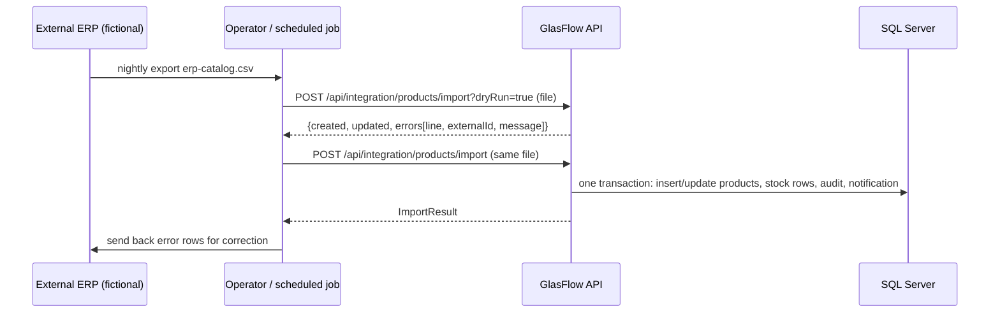

# ERP integration

GlasFlow is designed to sit next to an existing ERP (the corporate system of record) and exchange master data and documents with it. **No real ERP is connected in this project.** What is implemented is the integration surface, a working CSV import/export pipeline and identifier mapping, exercised with a fictional ERP file format.

## Status

| Capability | Status |
|---|---|
| REST API for every entity and workflow (JWT-secured, OpenAPI documented) | Implemented |
| External identifiers: `Products.ExternalId`, `Customers.ExternalId` (unique, filtered indexes), `SalesOrders.ExternalReference` (idempotency key) | Implemented |
| Product catalog CSV import with validation, column & category mapping, dry run, per-row error report, upsert by ExternalId | Implemented and tested |
| CSV export of products and customers with external ids; CSV export of every report | Implemented |
| Idempotent order intake (`externalReference` → 409 on duplicates) | Implemented and tested |
| Real-time connector to a specific ERP (SAP Business One, Dynamics, CONTPAQi, Odoo…) | Documented only |
| Outbound webhooks / message queue | Documented only |

## Example workflow: importing a product catalog

1. **Read**: RFC 4180 CSV (quotes, commas, embedded newlines, UTF-8 BOM tolerated).
2. **Map columns**: each GlasFlow field accepts several ERP header names (`GET /api/integration/mapping`):

   | GlasFlow field | Accepted headers | Required |
   |---|---|---|
   | ExternalId | `externalid`, `erp_sku`, `sku`, `item_id` | yes |
   | ProductCode | `productcode`, `code`, `codigo` | no (defaults to `ERP-<ExternalId>`) |
   | ProductName | `productname`, `name`, `nombre`, `descripcion_corta` | yes |
   | Category | `category`, `categoria`, `familia` | yes |
   | Unit | `unit`, `uom`, `unidad` (`sqm`→`m2`, `ea`/`pc`→`pza`, `m`→`ml`) | no (m2) |
   | Cost / SellingPrice / MinimumStock | `cost`/`costo`, `price`/`precio`, `min_stock`/`minimo` | price yes |
   | SupplierCode | `suppliercode`, `vendor`, `proveedor` | no |

3. **Map values**: ERP families → GlasFlow categories (`CLEAR`/`FLOAT` → Vidrio claro, `TEMPERED` → Vidrio templado, `LAMINATED` → Vidrio laminado, `DECORATIVE`/`FROSTED` → Vidrio decorativo, `ACCESSORY`/`HARDWARE` → Accesorios); supplier codes → supplier ids.
4. **Validate every row** before touching data: required fields, numeric formats, non-negative values, price ≥ cost, known category/unit/supplier, duplicate ExternalId within the file, product-code collisions.
5. **Apply**: rows are matched by `ExternalId` — existing products are updated, new ones created (with a zero stock row per warehouse). Invalid rows are skipped and reported with their line number; valid rows are saved in a single transaction, plus an audit entry and an "import completed" notification.
6. **Report**: `ImportResult { totalRows, created, updated, skipped, errors[], dryRun }`.

Try it: `samples/erp-product-catalog.csv` (clean) and `samples/erp-product-catalog-with-errors.csv` (one error of each kind), or the Integración page in the web UI.

## Integrating with a real ERP (design)

- **Master data in** (ERP → GlasFlow): products and customers through the CSV import or `POST/PUT /api/products|customers`, keyed by `ExternalId`. Scheduled with Windows Task Scheduler / SQL Agent / an integration platform.
- **Orders in**: ERP or e-commerce posts `POST /api/sales-orders` with `externalReference` = the ERP document number, which makes retries safe.
- **Documents out** (GlasFlow → ERP): confirmed/shipped orders and production receipts can be pulled with `GET /api/sales-orders?status=Shipped&from=…` and `GET /api/inventory/movements?from=…` (incremental by date), or read directly from the report views (`vw_SalesReport`, `vw_InventoryMovementHistory`) with a read-only SQL login. A production version would add outbound webhooks or an outbox table + queue for push delivery.
- **Invoicing (CFDI)**: Mexican e-invoicing would remain in the ERP/PAC; GlasFlow supplies RFC, tax zone, subtotal, IVA and totals per order.

## Error handling

Validation errors come back per row (import) or as ProblemDetails (API). Business conflicts are explicit: `409` for duplicate external references or codes, `422` for rule violations (e.g. insufficient stock), `404` for unknown ids. Every import and order change is audited.

## Authentication considerations

Integration clients should use a dedicated service account (role `Operator`) and a strong `Auth:JwtKey`; tokens expire (`Auth:TokenMinutes`). For production, recommended next steps are OAuth2 client-credentials (e.g. Entra ID) instead of password login, IP allow-listing, HTTPS everywhere, and a read-only SQL login for reporting/BI connections.
